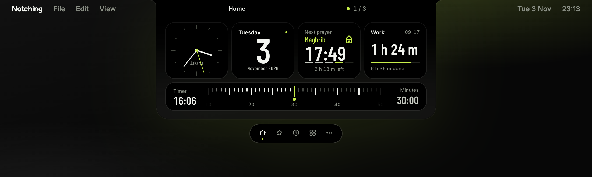
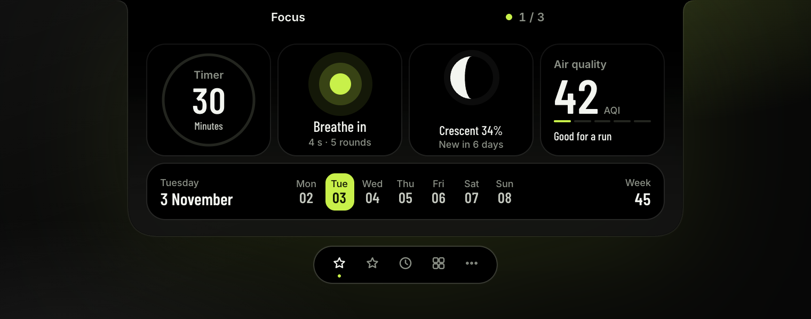
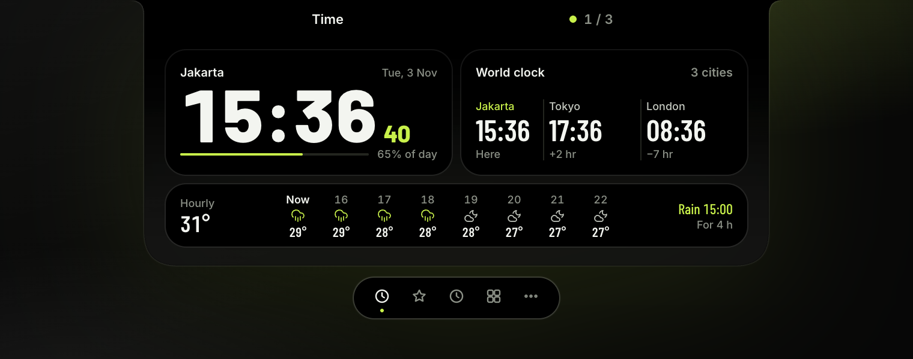
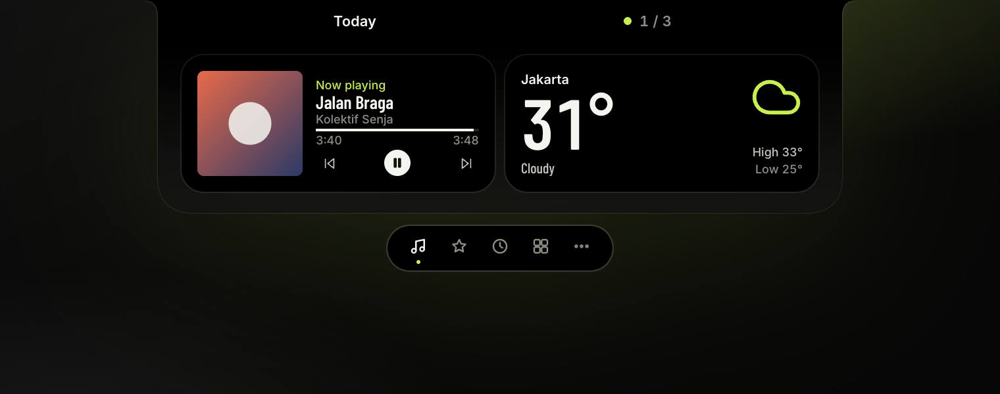
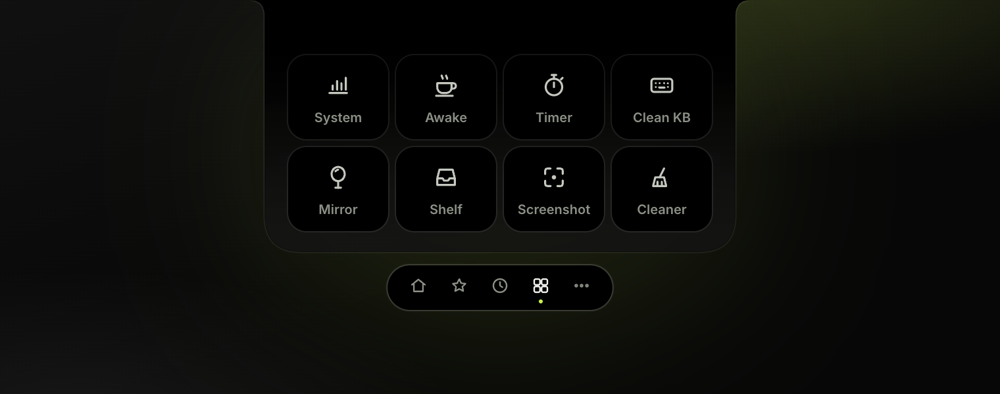

<h1 align="center">
  <picture>
    <source media="(prefers-color-scheme: dark)" srcset=".github/assets/logo-dark.png">
    
  </picture>
</h1>

<p align="center">
  <b>Your notch does more. Your computer barely notices.</b><br>
  Free. Open source. No tracking.
</p>

<p align="center">
  <a href="https://github.com/HamdaniAsril/notching/releases/latest"></a>
  
  
  
  <a href="LICENSE"></a>
</p>

<p align="center">
  <a href="https://github.com/HamdaniAsril/notching/releases/latest"><b>Download for Mac</b></a>
  ·
  Windows in the works
  ·
  <a href="#whats-inside">What's inside</a>
  ·
  <a href="#shortcuts">Shortcuts</a>
  ·
  <a href="#light-by-design">Light by design</a>
  ·
  <a href="#private-by-default">Privacy</a>
</p>

<p align="center">
  <b>8</b> modules &nbsp;·&nbsp; <b>25</b> widgets &nbsp;·&nbsp; <b>6.5 MB</b> download &nbsp;·&nbsp; <b>0.0%</b> CPU at rest
</p>

<p align="center">
  
</p>

---

The notch sits in the middle of your screen all day, doing nothing. Notching gives it a job: a calm black panel with the small tools you reach for every day. Click the notch and it opens. Click away or press Esc and it's gone.

## Pages you build

The pill under the notch holds your pages. Home comes first. Add as many of your own as you like, each with its own icon and a row of four columns. Widgets take one or two columns, with an optional strip underneath.

<p align="center">
  
  
</p>

## What's inside

**25 widgets, in six packs.**

| Pack | Widgets |
|---|---|
| Time | Clock, Clock + date, Analog clock, Calendar, Day of year, This week, World clock |
| Around | Weather, Weather large, Hourly weather, Air quality, Moon, Sun |
| Daily | Date, Prayer times (Kemenag RI method), Reminders |
| Plan | This week, Up next |
| Focus | Breathe, Work hours, Timer |
| Music | Now playing, in three sizes, with play, pause and skip |

<p align="center">
  
  
</p>

**8 modules, one click away.**

- **Timer.** Drag a ruler to set it. It ticks as you drag and counts down beside the notch.
- **Keep awake.** Your computer stays awake until you say so.
- **Shelf.** Start dragging a file and Shelf opens by itself. Drop it on the notch, drag copies out anywhere.
- **Screenshot.** Screen, window or area, straight to the clipboard, with an editor.
- **Cleaner.** Clears caches and removes apps with their leftovers. Everything goes to the Trash first.
- **Mirror.** Check your camera before a meeting.
- **Keyboard Cleaning Mode.** Locks the keyboard so you can wipe it.
- **System stat.** CPU and memory charts, the apps using the most, heat, network and storage.

Add or remove any of them, and any widget pack, from the Catalog in Settings. Nothing to download: it's all in the app already.

**3 background tools, no panel needed.**

- **Cut files.** ⌘X and ⌘V move files in Finder, just as they move text.
- **Arrange windows.** `⌃⌥` with an arrow key snaps the front window to half of its screen, with `;` `'` `.` `/` to a corner, with `\` to the centre, and with Return it fills the screen.
- **Window peek.** Point at a Dock icon to see every window of the app, minimized ones too; click the icon to minimize them all or bring them all back; ⌘Tab shows every window, minimized ones too. Install it from the Catalog.

## Shortcuts

Every key Notching listens for sits on one page in Settings. Click one to change it:

- ⌃⌥K turns Keep awake on and off.
- ⌃⌥V opens Shelf on the screen your pointer is on.
- ⌘⇧3 and ⌘⇧4 for Screenshot, once you hand them over from macOS.
- The ten keys of Arrange windows.
- ⌘Tab for Window peek's switcher, once it is installed (macOS's own ⌘Tab comes back whenever the switcher lets go).

Notching won't let two of its shortcuts share a key, and tells you when another app already has one.

## Lives beside the notch

When the panel is closed, the notch still tells you what's going on: the album cover and a soundwave while music plays, a countdown while Timer runs, a dot for a missed reminder.

<p align="center">
  
</p>

Pick your own accent color in Settings, and a light or dark Settings window. It also works on screens without a notch and on external displays.

## Keeps itself current, leaves cleanly

- **Updates from inside the app.** Settings → About checks for a new version once a day, and installs it in one click once Notching has checked Apple's signature.
- **What's new** in every version, right in Settings.
- **Uninstall from Settings.** Release every permission you gave Notching, or move Notching and all its files to the Trash in one go.

## Light by design

A notch app is open all day, so it has to cost you almost nothing. We spent a long time making sure it does.

- **6.5 MB download.** No Electron, no bundled browser. Notching is Rust and Tauri, and it draws with the web view your system already has.
- **Sleeps when you're not looking.** With the panel closed, every widget and module is unloaded. They come back only when you open the panel.
- **0.0% CPU at rest.** In our overnight test, 877 samples with the panel closed, Notching never went above 0.2%.
- **Quiet on the network.** Weather goes to Open-Meteo, and only when a page shows it. Once a day Notching asks GitHub for the latest version number. That's all.

## Private by default

- No account. No ads. No analytics.
- Network calls go to two places only:
  - [Open-Meteo](https://open-meteo.com), for weather, air quality and city search.
  - GitHub, once a day, for the latest version number. Nothing about you is sent. Turn it off in Settings → About.
- Everything else stays on your computer.
- The Mac app is signed with an Apple Developer ID and notarized by Apple. Before an update installs itself, Notching checks that the new app carries the same signature and passes Apple's Gatekeeper.
- MIT licensed. Read every line.

On macOS, some modules need a permission, which you grant once in System Settings:
- Screen Recording for Screenshot, and for Window peek's pictures of windows.
- Accessibility for Keyboard Cleaning Mode, Cut files, Arrange windows and Window peek.
- Full Disk Access for Cleaner.
- Camera for Mirror.

## Download

**Mac.** Download `Notching_x.y.z_aarch64.dmg` from the latest [Release](https://github.com/HamdaniAsril/notching/releases/latest), open it and drag Notching into Applications. Needs macOS 13 or later on Apple Silicon (M1 or newer).

**Windows.** In the works. Watch the repo to hear when it lands.

## Build from source

You need Node.js 20+, Rust (stable) and Xcode Command Line Tools.

```bash
npm ci
npm test
npm run tauri dev
```

To build the app and the DMG:

```bash
npm run tauri build
```

The output lands in `src-tauri/target/release/bundle/`.

## Releasing

Releases are built by [GitHub Actions](.github/workflows/release.yml) from a version tag:

1. Bump the version in `package.json`, `src-tauri/tauri.conf.json`, `src-tauri/Cargo.toml` and the `notching` entry in `src-tauri/Cargo.lock`.
   Give the version its date in `src/settings/changelog.ts` (Settings → What's new), and start the next one on top when work on it begins.
2. Commit, then `git tag vX.Y.Z && git push origin main vX.Y.Z`. The tag must equal the version.
3. CI runs the tests, builds for Apple Silicon, signs with Developer ID, notarizes, and attaches the DMG to a draft release.
4. When the run is green, publish it: `gh release edit vX.Y.Z --draft=false`.

The workflow needs these repository secrets: `APPLE_CERTIFICATE` (base64 `.p12`), `APPLE_CERTIFICATE_PASSWORD`, `APPLE_SIGNING_IDENTITY`, `APPLE_TEAM_ID`, `APPLE_ID` and `APPLE_PASSWORD` (an app-specific password).

## Project layout

- `src/`: the notch, settings window and shared kit (TypeScript).
- `src-tauri/`: the native side (Rust, Tauri 2 with tauri-nspanel).
- `modules/`: each module or widget pack is a web package with a `manifest.json`.
- `docs/superpowers/`: design documents, plans and verification notes, written in Indonesian.

## License

[MIT](LICENSE)

---

**Bahasa Indonesia.** Notch yang seharian diam di tengah layar, sekarang ada kerjanya. Notching mengubahnya jadi panel tenang berisi 8 modul dan 25 widget untuk keperluan sehari-hari. Ringan: unduhannya cuma 6,5 MB, tanpa Electron, dan saat panel tertutup CPU-nya 0,0%. Gratis, open source, tanpa iklan, dan tanpa pelacakan. [Unduh untuk Mac](https://github.com/HamdaniAsril/notching/releases/latest). Versi Mac sudah ditandatangani dan dinotarisasi Apple, jadi langsung bisa dibuka. Versi Windows sedang dibuat.
